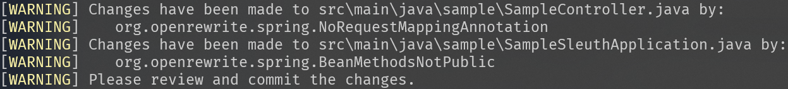
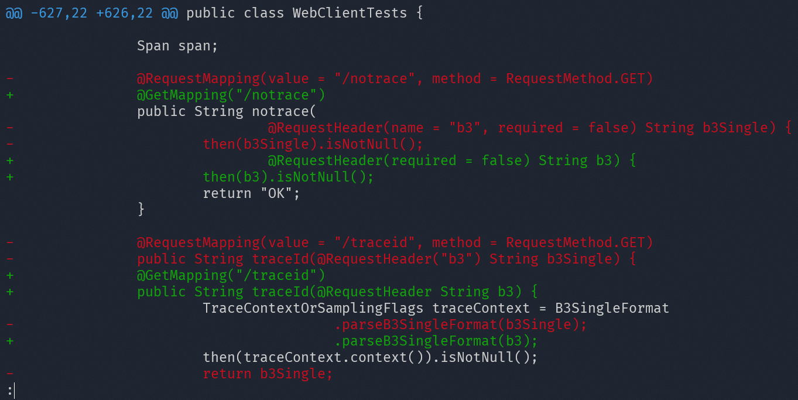
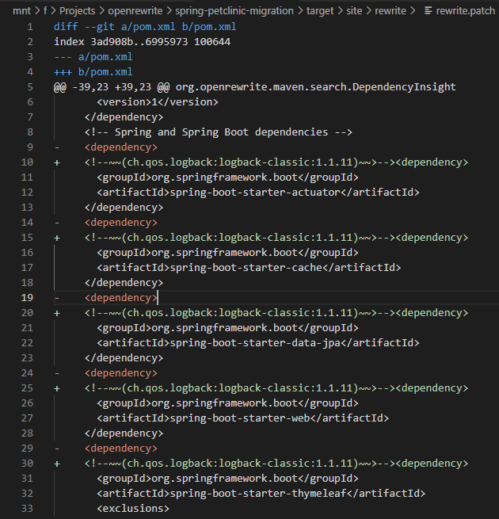
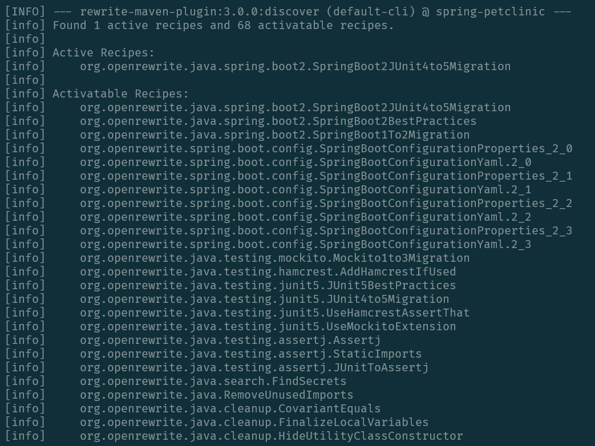
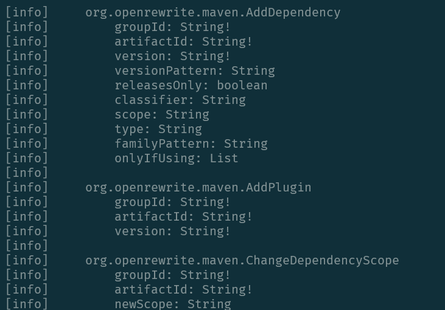

# Maven plugin configuration

The OpenRewrite Maven Plugin is the fastest way to apply OpenRewrite recipes to your code as part of your Maven build. The OpenRewrite Maven Plugin is compatible with all versions of Maven since 3.6.

:::tip
The OpenRewrite Maven plugin automatically supplies any recipes you configure to run with all source files in the project that are transformable. It will supply Java visitors with Java files, XML visitors with XML files, etc.
:::

The OpenRewrite Maven plugin offers these goals:

* `mvn rewrite:run` - Run the configured recipes and apply the changes locally.
* `mvn rewrite:runNoFork` - Run the configured recipes and apply the changes locally. This variant does not fork the Maven life cycle and can be a more efficient choice when using Rewrite within a CI workflow when combined with other Maven goals.
* `mvn rewrite:dryRun` - Generate warnings to the console for any recipe that would make changes and write them to a patch file in the `target/rewrite` folder of the top-level project, or of each module with `runPerSubmodule`.
* `mvn rewrite:dryRunNoFork` - Generate warnings to the console for any recipe that would make changes and write them to a patch file in the `target/rewrite` folder of the top-level project, or of each module with `runPerSubmodule`. This variant does not fork the Maven life cycle and can be a more efficient choice when using Rewrite within a CI workflow when combined with other Maven goals.
* `mvn rewrite:discover` - Generate a report of available recipes found on the classpath.
* `mvn rewrite:typetable` - [Generate a type table](/authoring-recipes/multiple-versions#typetable-generation-for-maven-projects) to support multiple versions of a single library.

:::info
_`rewrite`_ name-spaced properties can be used for substituting plugin properties:

* `-Drewrite.activeRecipes=org.example.R1, org.example.R2`
* `-Drewrite.activeStyles=org.example.Style`
* `-Drewrite.recipeArtifactCoordinates=org.example:your-recipe:1.0`
:::

:::info
The goals `rewrite:run` and `rewrite:dryRun` are configured to fork Maven's life cycle and are a better choice when running recipes via a stand-alone goal (`mvn rewrite:run`) because this will trigger all the necessary life-cycle goals prior to running rewrite's plugin. However, when using rewrite within the context of an integration build (`mvn deploy rewrite:run`) it may be more efficient to use the non-forking variants, as these will not cause duplicate life cycle phases to be called.
:::

:::info
In some circumstances, depending on how your project `pom.xml` is configured, you may get a [`NoPluginFoundForPrefixException`](https://cwiki.apache.org/confluence/display/MAVEN/NoPluginFoundForPrefixException). The root cause for this varies from `pom.xml` to `pom.xml`. In any case, as a quick fix to get unstuck, try referencing the fully-qualified rewrite-maven-plugin coordinates instead of the shorthand prefix. That is, try using `mvn org.openrewrite.maven:rewrite-maven-plugin:GOAL` (such as `mvn org.openrewrite.maven:rewrite-maven-plugin:run`, etc.) rather than `mvn rewrite:GOAL`.
:::

## Plugin configuration

It generally makes sense to apply the plugin to the root `pom.xml` in a repository so that the configuration applies to each project in a multi-module project. The table below lists the parameters of each goal, which you can set in the plugin's `<configuration>` or on the command line through their user property, such as `-Drewrite.activeRecipes=org.example.Recipe`. The [auto-generated rewrite-maven-plugin documentation](https://openrewrite.github.io/rewrite-maven-plugin/plugin-info.html) also shows their types.

<!-- AUTO-GENERATED-MAVEN-PARAMETERS:START - Do not edit manually; updated by ./gradlew updateMavenPluginParameters -->

| Parameter | User property | Default | Goals | Description |
| --------- | ------------- | ------- | ----- | ----------- |
| `activeRecipes` | `rewrite.activeRecipes` |  | All | The recipes to run, by the name they are given in their `specs.openrewrite.org/v1beta/recipe` resource. No recipe runs unless it is listed here. |
| `activeStyles` | `rewrite.activeStyles` |  | All | The styles to apply, by the name they are given in their `specs.openrewrite.org/v1beta/style` resource. No style is applied unless it is listed here. |
| `additionalPlainTextMasks` | `rewrite.additionalPlainTextMasks` |  | All | Files to parse as plain text in addition to the default masks, as glob patterns like those of `exclusions`. For example, `**/*.ext`. |
| `checkstyleConfigFile` | `rewrite.checkstyleConfigFile` |  | All | A Checkstyle configuration file to derive the coding style from, instead of detecting it from the Checkstyle plugin. |
| `checkstyleDetectionEnabled` | `rewrite.checkstyleDetectionEnabled` | `true` | All | Whether to derive the coding style from the configuration of the Checkstyle plugin, when the build uses it. |
| `configLocation` | `rewrite.configLocation` | `${maven.multiModuleProjectDirectory}/rewrite.yml` | All | The OpenRewrite YAML configuration file, as a path or an `http(s)` URL. A relative path is resolved against the directory of each module, so prefixing it with `${maven.multiModuleProjectDirectory}` has every module use the same file at the root of the repository. |
| `detail` | `detail` | `false` | `discover` | Whether to show the display name, description and options of each recipe. |
| `exclusions` | `rewrite.exclusions` |  | All | Paths not to parse, as [`PathMatcher`](https://docs.oracle.com/javase/8/docs/api/java/nio/file/PathMatcher.html) glob patterns relative to the root of the repository, where `**` matches any number of directories and `*` a single directory or file name. For example, `docs/**`. |
| `exportDatatables` | `rewrite.exportDatatables` | `false` | `dryRun`, `dryRunNoFork`, `run`, `runNoFork` | Whether to export the data tables that recipes produce as CSV files, to `target/rewrite/datatables`. |
| `failOnDryRunResults` | `failOnDryRunResults` | `false` | `dryRun`, `dryRunNoFork` | Whether to fail the build when recipes would make changes, to use the goal as a check in continuous integration. |
| `failOnInvalidActiveRecipes` | `rewrite.failOnInvalidActiveRecipes` | `false` | All | Whether to fail the build when an active recipe, or a recipe it includes, is not configured correctly. This may default to `true` in the future. |
| `options` | `rewrite.options` |  | `dryRun`, `dryRunNoFork`, `run`, `runNoFork` | Options to configure the active recipe with, as `key=value` pairs. Only a single recipe that does not include other recipes can be configured this way. For example, `-Drewrite.options=methodPattern=java.util.List add(..),key2=value2`. |
| `plainTextMasks` | `rewrite.plainTextMasks` |  | All | The files to parse as plain text, as glob patterns like those of `exclusions`, replacing the default masks. The defaults cover common text files without a dedicated parser, such as Markdown, shell scripts and Dockerfiles. Exclusions take precedence over plain text masks, and `additionalPlainTextMasks` has no effect when this is set. |
| `pomCacheDirectory` | `rewrite.pomCacheDirectory` |  | All | The directory to create the `.rewrite-cache` directory with cached POMs and Maven metadata in. Defaults to the user's home directory. Deleting the cache is safe, as it is populated again on the next run. |
| `pomCacheEnabled` | `rewrite.pomCacheEnabled` | `true` | All | Whether to cache downloaded POMs and Maven metadata on disk, in `pomCacheDirectory`. When disabled, an in-memory cache is used instead, which makes runs slower on projects with deep dependency trees. |
| `recipe` | `recipe` |  | `discover` | The name of a recipe to show, instead of every recipe. For example, `./mvnw rewrite:discover -Ddetail=true -Drecipe=org.openrewrite.java.format.AutoFormat`. |
| `recipeArtifactCoordinates` | `rewrite.recipeArtifactCoordinates` |  | All | Recipe artifacts to add, as `groupId:artifactId:version` coordinates, instead of or in addition to plugin dependencies. These are resolved from the repositories of the project rather than its plugin repositories. |
| `recipeChangeLogLevel` | `rewrite.recipeChangeLogLevel` | `WARN` | `dryRun`, `dryRunNoFork`, `run`, `runNoFork` | The level to log the changes that recipes make at: `ERROR`, `WARN`, `INFO` or `DEBUG`. |
| `recursion` | `recursion` | `0` | `discover` | How many levels of the recipes that a recipe includes to show. |
| `reportOutputDirectory` | `reportOutputDirectory` |  | `dryRun`, `dryRunNoFork` | The directory to write `rewrite.patch` to. Defaults to `target/rewrite` in the top-level project, or in each module when `runPerSubmodule` is enabled. |
| `resolvePropertiesInYaml` | `rewrite.resolvePropertiesInYaml` | `true` | All | Whether to resolve Maven properties, like `${project.artifactId}`, in the YAML configuration file. |
| `rewriteSkip` | `rewrite.skip` | `false` | All | Whether to skip the execution of the plugin, to disable it without removing its configuration. |
| `runPerSubmodule` | `rewrite.runPerSubmodule` | `false` | All | Whether to run recipes on each module separately, rather than once on all the modules of the build. |
| `sizeThresholdMb` | `sizeThresholdMb` | `10` | All | The size in megabytes above which files other than Java sources are not parsed. |
| `skipMavenParsing` | `skipMavenParsing` | `false` | All | Whether to skip parsing `pom.xml` files, and the POMs they inherit from, as source files. This can make runs faster when no recipe changes POMs. |

<!-- AUTO-GENERATED-MAVEN-PARAMETERS:END -->

To make recipe modules available to the plugin, add them as **plugin** dependencies, as in the example below. As `recipeArtifactCoordinates` are resolved from the project's repositories instead, using them requires the [Code Genome Project repository](/running-recipes/running-rewrite-on-a-maven-project-without-modifying-the-build#configure-the-code-genome-project-repository) to be declared as a `<repository>` in either your `pom.xml` or your `settings.xml`.

:::info
Note. the plugin scans the `compile`, `provided`, and `test` scopes for visitors, recipes, and styles and will automatically discover recipes on the project classpath.
:::

```xml title="pom.xml"
<project>
  <build>
    <plugins>
      <plugin>
        <groupId>org.openrewrite.maven</groupId>
        <artifactId>rewrite-maven-plugin</artifactId>
        <version>{{VERSION_REWRITE_MAVEN_PLUGIN}}</version>
        <configuration>
          <activeRecipes>
            <recipe>org.openrewrite.java.Spring</recipe>
          </activeRecipes>
          <activeStyles>
            <!-- This style is made up for sake of example. It isn't packaged with OpenRewrite -->
            <style>com.yourorg.SpringStyle</style>
          </activeStyles>
          <!-- These are default values, shown for example. It isn't necessary to supply these values manually: -->
          <configLocation>${maven.multiModuleProjectDirectory}/rewrite.yml</configLocation>
          <failOnDryRunResults>false</failOnDryRunResults>
          <exclusions>
            <exclusion>*/some/irrelevant/or/expensive/directory/**</exclusion>
          </exclusions>
          <additionalPlainTextMasks>
            <additionalPlainTextMask>**/.custom-ext</additionalPlainTextMask>
            <additionalPlainTextMask>**/.config-file</additionalPlainTextMask>
          </additionalPlainTextMasks>
          <plainTextMasks>
            <plainTextMask>**/.txt</plainTextMask>
          </plainTextMasks>
        </configuration>
        <dependencies>
          <!-- This module is made up for sake of example. It isn't packaged with OpenRewrite -->
          <dependency>
            <groupId>com.yourorg.recipes</groupId>
            <artifactId>your-recipes</artifactId>
            <version>1.1.0</version>
          </dependency>
        </dependencies>
      </plugin>
    </plugins>
  </build>
</project>
```


:::info
To find out what recipes a rewrite module provides, see its documentation and the output of the `rewrite:discover` goal.
:::

## The "TypeTable" goal

Execute `mvn rewrite:typetable` to [generate a type table](/authoring-recipes/multiple-versions#typetable-generation-for-maven-projects) to support multiple versions of a single library.

## The "Run" goal

Execute `mvn rewrite:run` to run the active recipes and apply the changes. This will write changes locally to your source files on disk. Afterward, review the changes, and when you are comfortable with the changes, commit them. The `run` goal generates warnings in the build log wherever it makes changes to source files.



After the goal finishes executing, run `git diff` to see what changes were made, review, and commit them.



## The "dryRun" goal

Execute `mvn rewrite:dryRun` to dry-run the active recipes and print which visitors would make changes to which files to the build log. This does not alter your source files at all. This goal can be used to preview the changes that would be made by a recipe.

`rewrite:dryRun` outputs a report in the form of a `patch` file, by default at `target/rewrite/rewrite.patch` in the top-level project, containing changes that would be made if you were to run `rewrite:run`. This file can be used with `git` to view or apply the potential changes. For example, `git apply target/rewrite/rewrite.patch`.



`dryRun` can be used as a "gate" in a continuous integration environment by failing the build if `dryRun` detects changes to be made and `failOnDryRunResults` is set to `true`:

```xml
<configuration>
  <failOnDryRunResults>true</failOnDryRunResults>
</configuration>
```

If desired, `dryRun` can be configured to bind `dryRun` to desired maven phases. For example, the following configuration is sufficient to have `mvn verify` also run `rewrite:dryRun`:

```xml title="pom.xml"
<!-- truncating the pom.xml for brevity -->
<project>
  <build>
    <plugins>
      <plugin>
        <artifactId>rewrite-maven-plugin</artifactId>
        <configuration>...</configuration>
        <!-- this 'executions' block is the important part of binding the dryRun goal to the verify phase -->
        <executions>
          <execution>
            <goals>
              <goal>dryRun</goal>
            </goals>
            <phase>verify</phase>
          </execution>
        </executions>
      </plugin>
    </plugins>
  </build>
</project>
```

## The "Discover" goal

Execute `mvn rewrite:discover` to list the recipes that the OpenRewrite Maven plugin has found on your classpath and the recipes that you have activated in your plugin configuration.



The [`detail`, `recipe` and `recursion` parameters](#plugin-configuration) narrow down or add to what it shows. For example, `mvn rewrite:discover -Ddetail=true -Drecipe=org.openrewrite.java.format.AutoFormat` shows the options of one recipe.



## Rewrite's pom cache

Rewrite's maven parser has its own resolution logic for pom files. (It will download metadata and poms from maven repositories). To speed up this process, there is a caching abstraction with two implementations (one that uses RocksDB and one that uses an in-memory cache to reduce the number of times a pom/metadata is downloaded from a repository.

The Maven plugin uses the RocksDB cache by default and will store this cache in `~/.rewrite-cache` . RocksDB is a high-performance, embedded database that is maintained by Facebook. The database engine is written in C++ and is used by the plugin via a JNI wrapper that has no transitive dependencies.

### Cache troubleshooting

In the very rare cases where the Maven plugin is unable to write to its on-disk folder or you encounter a serialization issue when reading/writing to the cache, there are several options available:

* Check if the folder is writable by the Maven process. The default folder location is under the user's home folder (`~/.rewrite-cache`) and you can choose an alternate location by using the plugin's `pomCacheDirectory` configuration property.
* It is safe to simply delete all of the contents within the cache folder. The first time the plugin is executed after deleting the cache, it will download and re-populate this cache folder.
* The `pomCacheEnabled` can be set to `false` in which case the plugin will use an in-memory cache instead. This will make running recipes slower when a project has deep dependency trees.

## Links

* [GitHub project](https://github.com/openrewrite/rewrite-maven-plugin)
* [Issue Tracker](https://github.com/openrewrite/rewrite-maven-plugin/issues)
